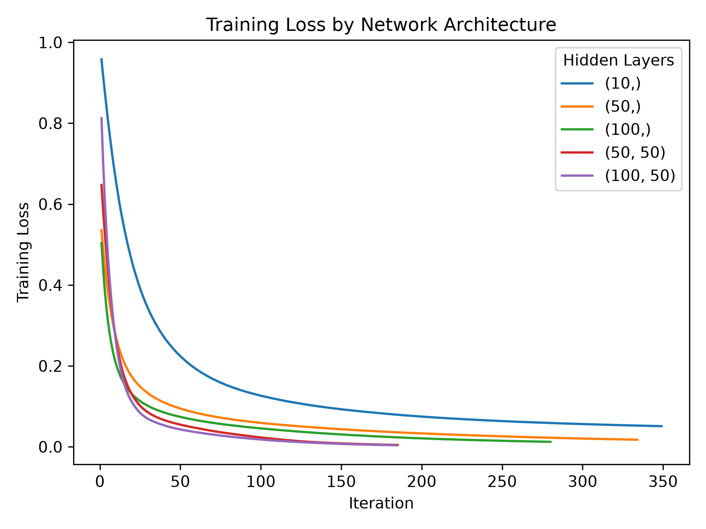

# Breast Cancer Classification with Neural Networks

This project uses scikit-learn's MLPClassifier to classify tumors
in the Breast Cancer Wisconsin dataset.

## Dataset
- 569 observations and 30 features
- Class 0: malignant (212 observations)
- Class 1: benign (357 observations)
- Training set: 398 observations
- Testing set: 171 observations

## Method
Features are standardized using statistics fitted only on the
training set. Five neural network architectures are compared using
ReLU activation, the Adam optimizer, and random_state=42.

Precision, recall, and F1-score use class 1 (benign) as the positive class.

## Results

| Hidden layers | Training accuracy | Testing accuracy | Testing F1 |
|---|---:|---:|---:|
| (10,) | 0.989950 | 0.976608 | 0.981132 |
| (50,) | 0.994975 | 0.970760 | 0.976303 |
| (100,) | 0.997487 | 0.982456 | 0.985915 |
| (50, 50) | 1.000000 | 0.970760 | 0.976303 |
| (100, 50) | 1.000000 | 0.976608 | 0.981132 |

The (100,) architecture performs best on this test split.
Increasing network size or depth does not always improve testing performance.

## Training Loss



## Files
- `hm4 code.py`: Data preparation, training, evaluation, and plotting
- `architecture_results.csv`: Architecture comparison results
- `training_loss.png`: Training loss curves

## How to Run

Install the dependencies:

```bash
python -m pip install numpy pandas matplotlib scikit-learn
```

Run the script:

```bash
python "hm4 code.py"
```
